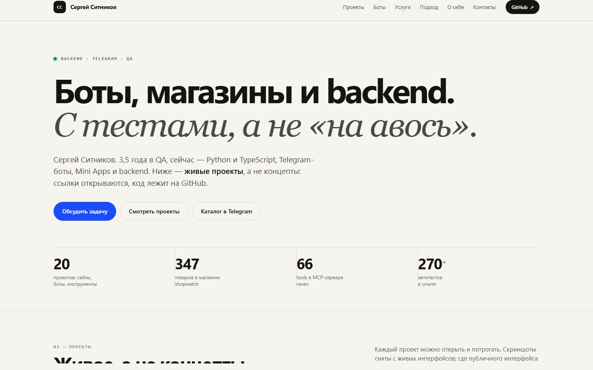

# ssrjkk.github.io

Projects and services hub: [ssrjkk.github.io](https://ssrjkk.github.io/).

One static page, no build step. It lists live projects with real screenshots, every project site, all
Telegram bots and channels, the services with prices, and contacts.



## Sections

- **Projects** — bothive, raven, wake, tippy, drafter, ezzoffer, harvest, shroud, agent-skills, QA frameworks
- **Bots** — [@ssrjkk_bot](https://t.me/ssrjkk_bot), [@waketrade_bot](https://t.me/waketrade_bot), [@tippy_on_base_bot](https://t.me/tippy_on_base_bot), [@harvest_testnet_bot](https://t.me/harvest_testnet_bot)
- **Sites** — twenty site addresses, including this hub; availability requires a complete HTTP response, and Wake API readiness is shown separately
- **Services** — Telegram bots, stores with TG/MAX bots, Mini Apps, full-stack web apps and automation
- **Contacts** — Telegram, GitHub, channels, email

## Live status

`status/worker.js` polls the twenty-two services listed on the hub every 15 minutes on Cloudflare Cron
Triggers and keeps the last 60 checks per service in Workers KV. The page reads the worker directly, so
a status update no longer needs a commit or a Pages rebuild.

| Endpoint | What it does |
| --- | --- |
| `GET /` | current payload: `probe_method`, `generated_at`, per-service `ok`, `code`, `ms`, `uptime`, `history` |
| `GET /health` | `OK` while the last run is under 30 minutes old, then `STALE`, `NO DATA` or `BAD DATA` |
| `POST /refresh` | runs a probe now, needs the `x-status-key` header to match the `STATUS_KEY` secret |

A service counts as up only when the response is read to the end — `Content-Length` equal to the bytes
received, body under 2 MB — and answers 2xx or 3xx; the Wake API additionally has to report
`{"status":"ready"}`. History from an older probe method is dropped rather than averaged, so an uptime
percentage never mixes two different rules.

Polling used to be a GitHub Actions `cron: "*/15 * * * *"`. The free-plan scheduler delays runs: gaps
between probes measured up to 7 h 53 min, while the page promised a quarter of an hour. Cloudflare
executes the schedule itself, and the hub now marks data older than two intervals as stale instead of
passing it off as live.

```bash
cd status
npm test          # 36 tests, no dependencies, no network
npm run coverage  # 100% lines, 98.85% branches, 100% functions
npx wrangler deploy
```

`wrangler secret put STATUS_KEY` sets the refresh key; its value stays out of the repository. Three
drift gates keep the list honest: every page the hub links must be polled, every polled `github.io`
page must be linked from the hub, and no workflow may reference the retired Actions producer.

## Run locally

```bash
python -m http.server 8100
# http://127.0.0.1:8100/
```

## Deploy

Push to `main`. GitHub Pages serves the repository root; `.nojekyll` keeps the `assets/` directory as is.

## Author

SSRJKK — [GitHub](https://github.com/ssrjkk) · [Telegram](https://t.me/ssrjkk) · [Bot catalogue](https://t.me/ssrjkk_bot)
