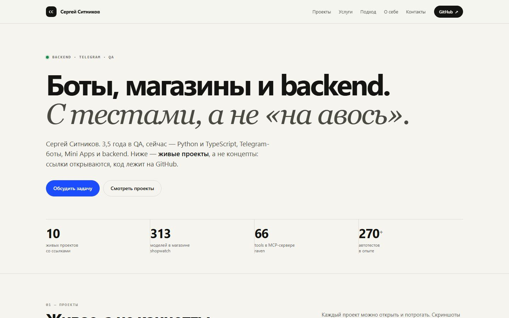

# ssrjkk.github.io

Projects and services hub: [ssrjkk.github.io](https://ssrjkk.github.io/).

One static page, no build step. It lists live projects with real screenshots, every project site, all
Telegram bots and channels, the services with prices, and contacts.



## Sections

- **Projects** — shopwatch, bothive, raven, wake, tippy, drafter, ezzoffer, harvest, shroud, agent-skills
- **Bots** — [@ssrjkk_bot](https://t.me/ssrjkk_bot), [@wwwatchshop_bot](https://t.me/wwwatchshop_bot), [@waketrade_bot](https://t.me/waketrade_bot), [@tippy_on_base_bot](https://t.me/tippy_on_base_bot), [@harvest_testnet_bot](https://t.me/harvest_testnet_bot)
- **Sites** — all eleven published sites, including this hub
- **Services** — Telegram bots, stores with TG/MAX bots, Mini Apps, QA and automation
- **Contacts** — Telegram, GitHub, channels, email

## Run locally

```bash
python -m http.server 8100
# http://127.0.0.1:8100/
```

## Deploy

Push to `main`. GitHub Pages serves the repository root; `.nojekyll` keeps the `assets/` directory as is.

## Author

SSRJKK — [GitHub](https://github.com/ssrjkk) · [Telegram](https://t.me/ssrjkk) · [Bot catalogue](https://t.me/ssrjkk_bot)
