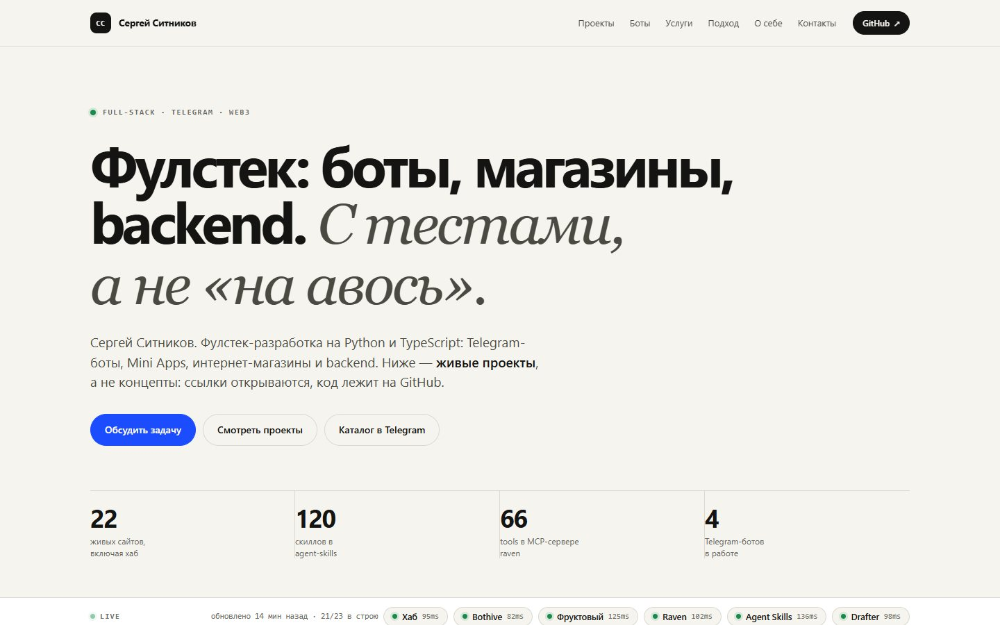

# ssrjkk.github.io

Хаб проектов и услуг: [ssrjkk.github.io](https://ssrjkk.github.io/).

Одна статическая страница без сборки. В ней перечислены живые проекты с реальными скриншотами, все
сайты проектов, Telegram-боты и каналы, услуги с ценами и контакты.



## Разделы

- **Проекты** — 22 карточки, по одной на проект каталога: bothive, fruktovy, our-jamon, raven, twinby-swipe-bot, wake, tippy-on-base, drafter, ezzoffer, harvest, shroud, agent-skills, qualix, qa-arsenal, mobius, noema, volley, b2w-crypto-tg-bot, tt_bot, corvid_crm, verso, ssrjkk.github.io. Каждая карточка ведёт на сайт, документацию из записи каталога, репозиторий, бота, если он есть, и deep-link `?start=p_<name>` в [@ssrjkk_bot](https://t.me/ssrjkk_bot)
- **Боты** — [@ssrjkk_bot](https://t.me/ssrjkk_bot), [@waketrade_bot](https://t.me/waketrade_bot), [@tippy_on_base_bot](https://t.me/tippy_on_base_bot), [@harvest_testnet_bot](https://t.me/harvest_testnet_bot), [@ezzoffer_bot](https://t.me/ezzoffer_bot)
- **Сайты** — 22 адреса, включая сам хаб; доступность требует полного HTTP-ответа, а готовность Wake API показывается отдельно
- **Услуги** — Telegram-боты, магазины с TG/MAX-ботами, Mini Apps, full-stack веб-приложения и автоматизация
- **Контакты** — Telegram, GitHub, каналы, email

## Живой статус

`status/worker.js` опрашивает 30 сервисов из хаба каждые 15 минут через Cloudflare Cron Triggers и
хранит последние 60 проверок каждого сервиса в Workers KV. Страница читает воркер напрямую, поэтому
обновление статуса больше не требует коммита или пересборки Pages.

| Endpoint | Что делает |
| --- | --- |
| `GET /` | текущий payload: `probe_method`, `generated_at`, `ok`, `code`, `ms`, `uptime`, `history` по сервисам |
| `GET /health` | `OK`, если последний прогон не старше 30 минут; затем `STALE`, `NO DATA` или `BAD DATA` |
| `POST /refresh` | запускает проверку сейчас; заголовок `x-status-key` должен совпасть с секретом `STATUS_KEY` |

Сервис считается доступным только когда ответ прочитан целиком — `Content-Length` совпадает с числом
полученных байт, тело меньше 2 МБ — и возвращает 2xx или 3xx; Wake API дополнительно должен вернуть
`{"status":"ready"}`. История старого метода проверки отбрасывается, а не усредняется, поэтому uptime
не смешивает разные правила.

Раньше опрос выполнялся через GitHub Actions `cron: "*/15 * * * *"`. Бесплатный планировщик задерживает
запуски: измеренные паузы доходили до 7 ч 53 мин, хотя страница обещала четверть часа. Cloudflare
выполняет расписание сам, а хаб помечает данные старше двух интервалов как устаревшие вместо того,
чтобы выдавать их за живые.

```bash
cd status
npm test          # 36 тестов, без зависимостей и сети
npm run coverage  # 100% lines, 98.85% branches, 100% functions
npx wrangler deploy
```

`wrangler secret put STATUS_KEY` задаёт ключ обновления; его значение не хранится в репозитории. Три
гейта расхождения держат список честным: каждая страница из хаба должна проверяться, каждая проверяемая
страница `github.io` должна быть в хабе, а workflow не может ссылаться на снятый Actions-продюсер.

## Локальный запуск

```bash
python -m http.server 8100
# http://127.0.0.1:8100/
```

## Деплой

Пуш в `main`. GitHub Pages отдаёт корень репозитория; `.nojekyll` сохраняет каталог `assets/` как есть.

## Автор

SSRJKK — [GitHub](https://github.com/ssrjkk) · [Telegram](https://t.me/ssrjkk) · [Каталог-бот](https://t.me/ssrjkk_bot)
